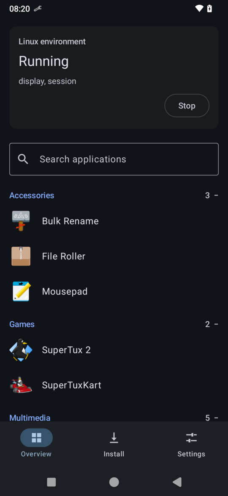
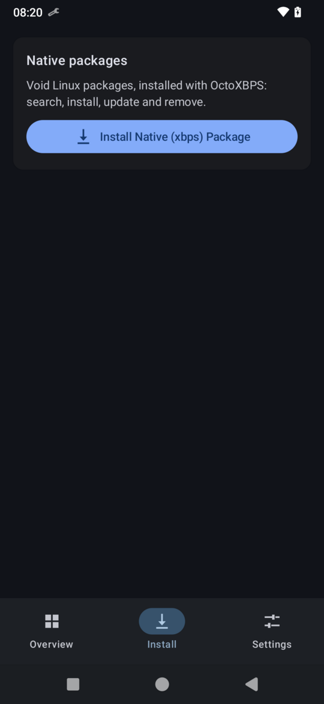
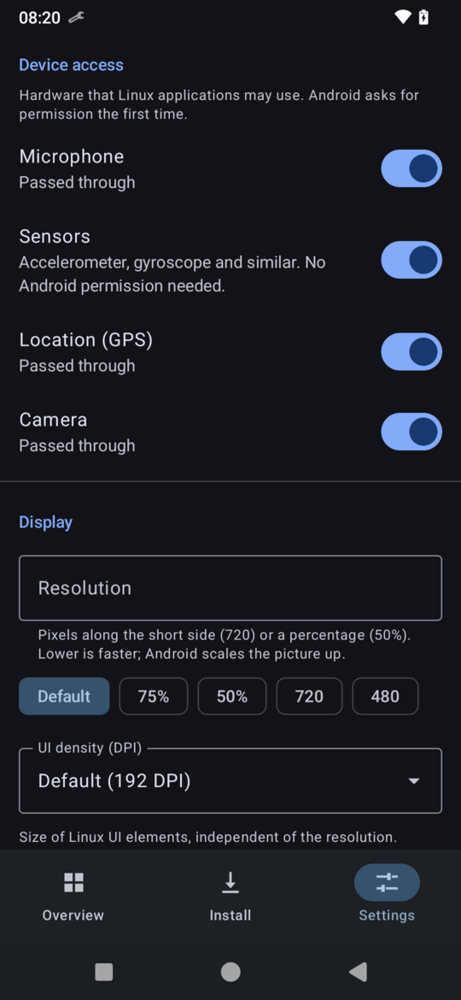
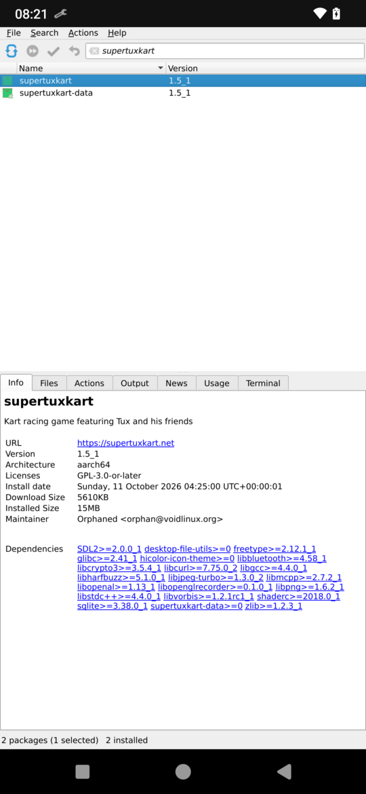
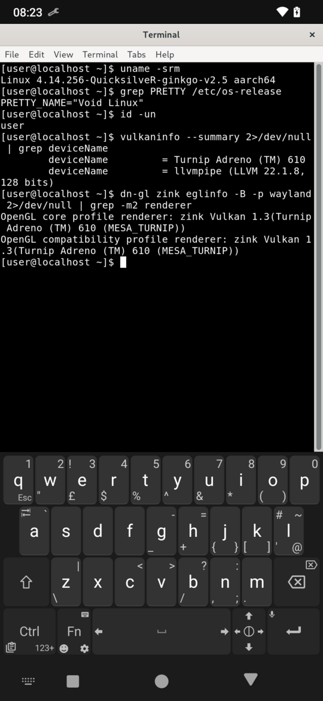
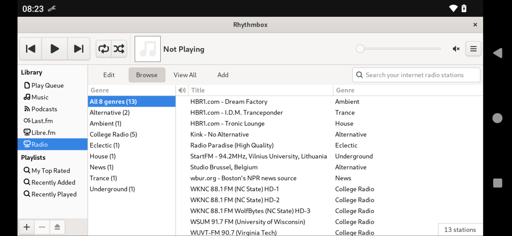

# DroidNative

DroidNative runs real Linux desktop applications on Android phones and
tablets. Each Linux app opens in its own Android window, next to your other
apps, with GPU accelerated graphics, sound, the on-screen keyboard and
access to your files, camera, microphone and sensors.

- **Easy to use:** install the app, tap Install once, then open Linux apps
  from a list or from your home screen like any other app.
- **For Linux developers:** a full Void Linux system (glibc) with Wayland,
  Xwayland, Vulkan, OpenGL, PulseAudio and D-Bus. Existing GTK, Qt, SDL and
  X11 software runs unchanged, so phone and tablet support starts with the
  program you already have.
- **Highly compatible:** native packages (xbps, over 14000 of them), Flatpak
  and AppImage. Hardware Vulkan and OpenGL on Qualcomm Adreno GPUs through
  Mesa (Turnip, Zink), software rendering elsewhere.
- **No root, stock Android:** no unlocked bootloader, no root, no custom
  ROM. Android 7.0 (API 24) and newer, from 32-bit ARM to 64-bit ARM and
  x86.

DroidNative is in active development. It is tested on a Redmi Note 8T
(Android 13, Adreno 610).

## Screenshots

<table>
  <tr>
    <td></td>
    <td></td>
    <td></td>
  </tr>
  <tr>
    <td></td>
    <td></td>
    <td></td>
  </tr>
  <tr>
    <td colspan="3"></td>
  </tr>
</table>

Overview, Install, Settings, OctoXBPS, Xfce Terminal and Rhythmbox, taken on
the phone.

## Using DroidNative

**Getting started**

1. Install the APK. Use the `fdroid` build on Android 7 to 9 and the `play`
   build on Android 10 and newer (either works on newer phones).
2. Open DroidNative and tap **Install** on the Overview tab. It downloads
   the Linux system and the default apps (about 1 GB), so use Wi-Fi.
3. When the card says **Running**, your applications appear below it.

**Everyday use**

- **Open an app:** tap it in the list. It opens in its own window and shows
  up in Android's recent apps. Close it from there or from inside the app.
- **Find apps:** apps are sorted into categories like on a Linux desktop;
  use the search field at the top.
- **Long press an app** for more:
  - **Add to home screen** puts it on your launcher like a normal app.
  - **Change per-app settings** sets graphics, resolution, screen
    density, touch input and rotation for that app only.
- **Install more software:** on the **Install** tab, tap **Install Native
  (xbps) Package**. OctoXBPS opens; search, tick and apply.
- **Typing:** the keyboard opens by itself when a text field is active.
- **Terminal:** Xfce Terminal is preinstalled. You are the user `user`;
  `sudo` works without a password.

**Settings tab**

- **Device access:** let Linux apps use the microphone, sensors, location
  and cameras. Android asks for permission the first time.
- **Display:** a lower resolution (for example `50%`) is faster; the UI
  density changes how large Linux apps look. **Touch input** chooses
  between real touch, a finger as mouse, or the screen as a touchpad.
- **All files access:** your phone storage appears in Linux at
  `/media/sdcard`, memory cards at `/media/<card id>`.

Changes to device access and storage apply after you stop and start the
environment on the Overview tab.

**If apps get closed in the background (Android 12 and newer):** Android
limits how many background processes an app may have. Turn on "Disable
child process restrictions" in the developer options (Android 14 and
newer), or run once from a computer:
`adb shell settings put global settings_enable_monitor_phantom_procs false`

## For developers

Inside the environment you have a normal Void Linux system
(`xbps-install`, `/usr`, systemd-free, glibc). Things worth knowing when
targeting phones and tablets:

- Wayland is the default (`WAYLAND_DISPLAY=wayland-0`); X11 programs use
  rootless Xwayland on `DISPLAY=:0`. Every toplevel window becomes an
  Android window and is resized to it, so layouts must cope with narrow
  portrait and wide landscape sizes.
- Text fields should use the Wayland text-input protocol (GTK and Qt do)
  so the on-screen keyboard opens.
- Hardware: cameras are V4L2 devices (`/dev/videoN`), sensors use the IIO
  sysfs layout, location is an NMEA stream at `/dev/gps0`, the microphone
  is the PulseAudio source `android_mic`. See
  [docs/device-passthrough.md](docs/device-passthrough.md).
- `dn-gl <auto|zink|gl4es|llvmpipe> <command>` picks the OpenGL backend
  for one program.

More: [docs/architecture.md](docs/architecture.md),
[docs/per-app-settings.md](docs/per-app-settings.md) and
[docs/testing.md](docs/testing.md).

### Build dependencies

Debian or Ubuntu:

```
sudo apt install openjdk-17-jdk build-essential git curl patch python3 \
    libexpat1-dev xz-utils docker.io adb
```

Void Linux:

```
sudo xbps-install openjdk17 base-devel git curl patch python3 expat-devel \
    xz docker android-tools
```

Your user must be allowed to use Docker (`docker` group, log in again
afterwards). The Linux packages are built in a privileged Void container.

Android SDK (with Android Studio's SDK manager or the command line tools):
`platforms;android-37`, `build-tools;37.0.0`, `ndk;29.0.14206865`,
`cmake;4.1.2`.

### Building

```
# 1. Point Gradle at the SDK
echo "sdk.dir=$HOME/Android/Sdk" > local.properties

# 2. Android-side executables (PRoot, libffi, libwayland-server) for all ABIs
native-host/build.sh

# 3. Linux-side packages (Mesa with Turnip/Zink, gl4es, tools), per
#    architecture; the first run builds Mesa and takes a while
for arch in aarch64 armv7l x86_64 i686; do linux-side/build-packages.sh -a "$arch"; done

# 4. The app: play (Android 10+) or fdroid (Android 7+) flavour
./gradlew assemblePlayDebug
./gradlew assembleFdroidDebug

# 5. Install on a phone with USB debugging
adb install -r app/build/outputs/apk/play/debug/app-play-debug.apk
```

Downloads and build trees go to `.cache/`. Tests are described in
[docs/testing.md](docs/testing.md).

## What makes it work

The core components DroidNative builds on, with their sources:

| Component | Used for | Source | Licence |
|---|---|---|---|
| Void Linux | the Linux system (rootfs and packages) | https://voidlinux.org | various |
| xbps, xbps-src | package manager, package builds | https://github.com/void-linux/xbps, https://github.com/void-linux/void-packages | BSD-2-Clause |
| PRoot (Termux fork) | runs Linux without root; patched for Flatpak, V4L2 and more | https://github.com/termux/proot | GPL-2.0 |
| talloc | PRoot dependency | https://talloc.samba.org | LGPL-3.0 |
| libffi | libwayland dependency | https://github.com/libffi/libffi | MIT |
| Wayland | compositor library and protocol code generator | https://gitlab.freedesktop.org/wayland/wayland | MIT |
| wayland-protocols | xdg-shell, linux-dmabuf, text-input, xwayland-shell | https://gitlab.freedesktop.org/wayland/wayland-protocols | MIT |
| Mesa | Vulkan (Turnip) and OpenGL (Zink), patched | https://mesa3d.org | MIT |
| gl4es | alternative OpenGL backend | https://github.com/ptitSeb/gl4es | MIT |
| Xwayland | X11 applications | https://gitlab.freedesktop.org/xorg/xserver | MIT |
| libxcb | X window manager (dn-xwm) | https://xcb.freedesktop.org | MIT |
| PulseAudio | sound output and microphone | https://www.freedesktop.org/wiki/Software/PulseAudio/ | LGPL-2.1 |
| D-Bus | session bus | https://www.freedesktop.org/wiki/Software/dbus/ | AFL-2.1 or GPL-2.0 |
| Flatpak | Flatpak applications | https://flatpak.org | LGPL-2.1 |
| bubblewrap | Flatpak sandbox | https://github.com/containers/bubblewrap | LGPL-2.0 |
| OctoXBPS | package manager UI of the Install tab | https://github.com/aarnt/octoxbps | GPL-2.0 |
| Kotlin | app language | https://kotlinlang.org | Apache-2.0 |
| AndroidX, Jetpack Compose | app UI | https://developer.android.com/jetpack | Apache-2.0 |
| XZ for Java | unpacking the Linux system | https://tukaani.org/xz/java.html | 0BSD |
| Android NDK | building the native parts | https://developer.android.com/ndk | Apache-2.0 |

## Licence

DroidNative is free software under the GNU General Public License,
version 3 or later; see [COPYING](COPYING). PRoot ships as a separate
GPL-2.0 executable alongside it.
